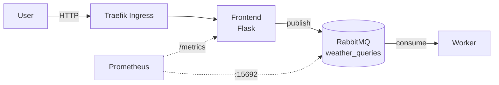

# SkyWatch

A small distributed weather-query pipeline, built end to end: application code, tests, CI/CD, infrastructure as code and monitoring.

A Flask frontend takes a city name and publishes a job to RabbitMQ; a worker service consumes the queue and processes it. Everything runs on a self-provisioned K3s cluster on AWS.



## Stack

| Area | Tools |
|---|---|
| Application | Python 3.11, Flask, pika (RabbitMQ) |
| Testing | pytest, pytest-mock |
| CI/CD | GitHub Actions, GHCR, flake8 |
| Infrastructure | Terraform (AWS EC2), Ansible, K3s |
| Deployment | Helm, Traefik Ingress |
| Observability | Prometheus (`prometheus-flask-exporter`, ServiceMonitors) |

## Repository layout

```
app/frontend/   Flask web app: form, /query, /healthz, /metrics
app/worker/     RabbitMQ consumer with reconnect/retry loop
tests/          pytest unit tests for the frontend
helm/skywatch/  Helm chart: frontend, worker, RabbitMQ, ingress, ServiceMonitors
terraform/      AWS infra: security group, 3 EC2 nodes, generated Ansible inventory
ansible/        Installs K3s master and joins the worker nodes
.github/        CI/CD pipeline
```

## CI/CD pipeline

On every push and pull request to `main`:

1. **Lint**: flake8 on the frontend and worker.
2. **Test**: pytest suite (RabbitMQ is mocked).
3. **Build & push** (on push to `main` only): builds both Docker images and pushes them to GHCR, tagged with the short commit SHA.
4. **GitOps tag bump**: updates the image tags in `helm/skywatch/values.yaml` and commits back with `[skip ci]`, so the chart always points to an immutable, traceable image.

## Tests

`tests/test_frontend.py` covers:

- the `/healthz` endpoint used by Kubernetes probes
- a successful query: the message is published to the right durable queue and the connection is closed
- input validation: an empty or whitespace-only city returns `400`
- failure handling: a RabbitMQ connection error returns `500` with details

```bash
pip install -r app/frontend/requirements.txt pytest pytest-mock
pytest -v
```

## Deploy

```bash
# 1. Provision 3 EC2 nodes (1 master, 2 workers) and generate the Ansible inventory
cd terraform && terraform init && terraform apply

# 2. Install K3s and join the workers
ansible-playbook -i ../ansible/inventory.ini ../ansible/playbook.yml

# 3. Deploy the app
helm upgrade --install skywatch ./helm/skywatch -n skywatch --create-namespace
```

The app is served at `http://skywatch.local` through the Traefik ingress. The ServiceMonitors expect a `kube-prometheus-stack` release in the cluster.
