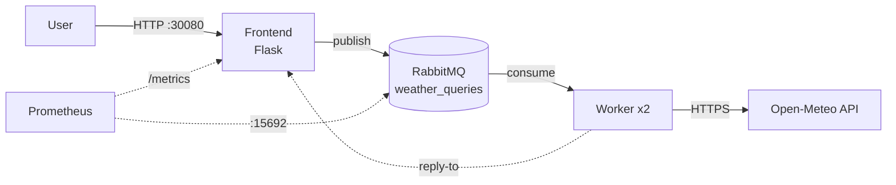

# SkyWatch

A small distributed weather-query pipeline, built end to end: application code, tests, CI/CD, infrastructure as code and monitoring.

A Flask frontend takes a city name and publishes a job to RabbitMQ; a worker consumes the queue, looks the city up in the free [Open-Meteo](https://open-meteo.com) API and replies with the current weather, which the frontend shows to the user. Everything runs on a self-provisioned K3s cluster on AWS.



## Stack

| Area | Tools |
|---|---|
| Application | Python 3.11, Flask, pika (RabbitMQ) |
| Testing | pytest, pytest-mock |
| CI/CD | GitHub Actions, GHCR, flake8 |
| Infrastructure | Terraform (AWS EC2), Ansible, K3s |
| Deployment | Helm, ArgoCD (GitOps) |
| Observability | kube-prometheus-stack: Prometheus + Grafana (`prometheus-flask-exporter`, ServiceMonitors) |

## Repository layout

```
app/frontend/   Flask web app: form, /query, /healthz, /metrics
app/worker/     RabbitMQ consumer with reconnect/retry loop
tests/          pytest unit tests for the frontend
helm/skywatch/  Helm chart: frontend, worker, RabbitMQ, ingress, ServiceMonitors
terraform/      AWS infra: security group, 3 EC2 nodes, generated Ansible inventory
ansible/        Installs K3s master and joins the worker nodes
.github/        CI/CD pipeline
```

## CI/CD pipeline

On every push and pull request to `main`:

1. **Lint**: flake8 on the frontend and worker.
2. **Test**: pytest suite (RabbitMQ is mocked).
3. **Build & push** (on push to `main` only): builds both Docker images and pushes them to GHCR, tagged with the short commit SHA.
4. **GitOps tag bump**: updates the image tags in `helm/skywatch/values.yaml` and commits back with `[skip ci]`, so the chart always points to an immutable, traceable image.

## Tests

`tests/test_frontend.py` covers:

- the `/healthz` endpoint used by Kubernetes probes
- a successful query: the job is published to the durable queue with a reply-to address and the worker's reply is returned
- input validation: an empty or whitespace-only city returns `400`
- unknown city `404`, worker timeout `504`, RabbitMQ connection error `500`

`tests/test_worker.py` covers the Open-Meteo lookup (mocked HTTP), unknown cities, API failures, and that the worker replies and acks (or nacks bad messages).

```bash
pip install -r app/frontend/requirements.txt -r app/worker/requirements.txt pytest pytest-mock
pytest -v
```

## Deploy

The workers are `t3.micro` (free tier) and the master is `t3.small`; see [Why the master is t3.small](#why-the-master-is-t3small). K3s is pinned to `v1.29.5+k3s1`, every node gets 2 GB swap, Traefik and metrics-server are disabled and the master is tainted `NoSchedule`.

| Node | Type | Workloads |
|---|---|---|
| skywatch-master | t3.small | K3s control plane only |
| skywatch-worker | t3.micro | ArgoCD, Grafana, Prometheus operator, kube-state-metrics |
| skywatch-worker2 | t3.micro | SkyWatch app, Prometheus |

```bash
# 1. Provision 3 EC2 nodes and generate the Ansible inventory
cd terraform && terraform init && terraform apply

# 2. Install K3s, swap and join the workers (writes ./kubeconfig)
cd ../ansible && ansible-playbook -i inventory.ini playbook.yml
cd .. && export KUBECONFIG=$(pwd)/kubeconfig

# 3. Monitoring (CRDs first, then the chart with helm/monitoring/values.yaml)
./scripts/install-monitoring.sh

# 4. ArgoCD, pinned to skywatch-worker, then the skywatch Application (auto-sync from Git)
./scripts/install-argocd.sh

# 5. At the end of the session, stay in the free tier
cd terraform && terraform destroy
```

| Service | URL |
|---|---|
| SkyWatch | `http://<worker2-ip>:30080` |
| ArgoCD | `https://<any-node-ip>:30081` (admin / printed by the script) |
| Grafana | `http://<any-node-ip>:30030` (admin / skywatch-grafana) |
| RabbitMQ management | `kubectl port-forward svc/rabbitmq -n skywatch 15672:15672` |

## Lessons learned

### Why the master is t3.small

The course spec asks for three `t3.micro` nodes (1 vCPU, 1 GB RAM). Workers run fine on that, but a `t3.micro` master did not survive the full stack:

1. The K3s server alone used ~430 MB of the 914 MB, so the node lived in swap (75% I/O wait).
2. Installing ArgoCD's CRDs timed out the K3s datastore writes and the server crashed and restarted.
3. With ArgoCD and kube-prometheus-stack installed, API calls (e.g. `/openapi/v2`) hit 30 s timeouts. CoreDNS could not reach the API, so in-cluster DNS failed and the frontend could not resolve `rabbitmq`.
4. After a reboot the server crash-looped on startup: `failed to register CRDs: the server was unable to return a response`. It could not register all CRDs before its own startup deadline.

Disabling metrics-server and Prometheus scraping of the master reduced load but could not fix (4), since it happens before any workload runs. The master was moved to `t3.small` (2 GB, about $0.02/hour in eu-west-1); the workers stay on `t3.micro`. Destroy the cluster after every session.

### Other findings

| Finding | Takeaway |
|---|---|
| Worker2 thrashed with Prometheus, Grafana, the operator and the app on 1 GB | Keep only Prometheus next to the app; put the light monitoring components on the ArgoCD node |
| The latest-Ubuntu AMI lookup makes `terraform plan` replace all nodes whenever Canonical publishes a new image | Fine for a destroy-every-session cluster; add `lifecycle { ignore_changes = [ami] }` for a long-lived one |
| Default EC2 hostnames (`ip-172-...`) broke `kubernetes.io/hostname` node selectors | Pass `--node-name` to K3s |
| The master instance type was changed in the AWS console, outside Terraform | Change infrastructure only through Terraform, or `plan` shows drift |

